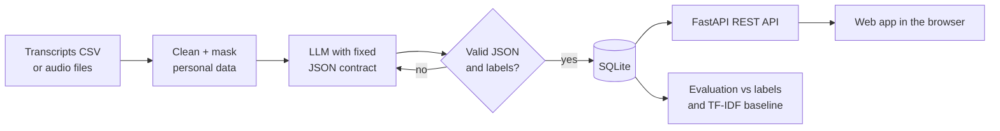

# Customer Conversation Intelligence

An LLM pipeline that reads customer-support conversations (English, Hindi or Hinglish) and turns each one into structured data: a summary, the customer's intent, sentiment, whether the issue was resolved, a priority, a recommended next action, and an agent-quality checklist. It runs as a **REST API (FastAPI)** with a **web app in the browser**, stores results in SQLite, and includes an evaluation that measures accuracy against labelled data and against a classical TF-IDF baseline.

The data is synthetic and modelled on a rental and home-services platform (rental agreements, deposits, packers and movers, home services, paid plans, rent payments, listings). The fictional company is called RentEasy. No real customer data is used.



## What you get

| Output field | Example |
|---|---|
| `summary` | Customer's UPI rent payment failed but money was deducted; reversal promised within a week. |
| `intent` | `payment_issue` (one of 9 domain intents, see `src/config.py`) |
| `sentiment` | `negative` (customer's mood at the end of the call) |
| `resolution_status` | `partially_resolved` |
| `priority` | `high` |
| `next_action` | Track the reversal with the payment gateway and update the customer. |
| `agent_qa` | greeted, verified details, showed empathy, offered a resolution (yes/no each, plus a 0–100 score) |

## Project layout

```
convo-insights/
├── frontend/               web app (HTML, CSS, JS) served by the API at /
│   ├── index.html
│   ├── styles.css
│   └── app.js
├── app.py                  optional Streamlit dashboard (older alternative to the web app)
├── requirements.txt
├── .env.example            copy to .env and pick a provider
├── .streamlit/config.toml  dashboard theme
├── src/
│   ├── config.py           labels, paths, provider settings (single source of truth)
│   ├── generate_data.py    synthetic labelled conversations, train/test split
│   ├── pii.py              masks phone, email, UPI, card, Aadhaar, PAN
│   ├── schema.py           Pydantic model the LLM output must match
│   ├── llm_client.py       LLM providers: groq, gemini, ollama, anthropic, openai, and the offline mock
│   ├── check_llm.py        `python -m src.check_llm`: tests your LLM setup and explains problems
│   ├── extractor.py        prompt, JSON parsing, validation, retries
│   ├── db.py               SQLite storage
│   ├── api.py              FastAPI app: REST endpoints, background jobs, serves the frontend
│   ├── analytics.py        filters and dashboard aggregates
│   ├── pipeline.py         batch processing (used by the CLI and the API)
│   ├── baseline.py         TF-IDF + logistic regression comparison model
│   ├── evaluate.py         metrics, confusion matrix, error list, report
│   └── transcribe.py       optional speech-to-text for call recordings
├── tests/                  unit and API tests (no API key needed)
├── data/                   CSVs and the SQLite database
├── models/                 saved baseline model
└── reports/                evaluation outputs
```

## Running it end to end

You need Python 3.10 or newer. Every command below is run from the `convo-insights` folder.

The project first runs completely offline, using a keyword-based **mock** in place of the LLM, so you can check that every part works before setting anything up. Connecting a real LLM (free options included) is covered step by step in [Using an LLM](#using-an-llm-step-by-step) after this section.

### 1. Create a virtual environment and install dependencies

macOS / Linux:

```bash
python3 -m venv .venv
source .venv/bin/activate
pip install -r requirements.txt
```

Windows (PowerShell):

```powershell
python -m venv .venv
.venv\Scripts\Activate.ps1
pip install -r requirements.txt
```

If PowerShell blocks the activation script, run `Set-ExecutionPolicy -Scope CurrentUser RemoteSigned` once and try again.

### 2. Create your settings file

macOS / Linux: `cp .env.example .env`
Windows: `copy .env.example .env`

Leave `LLM_PROVIDER=mock` for now; you will change it in [Using an LLM](#using-an-llm-step-by-step).

### 3. Run the tests

```bash
pytest -q
```

All 19 tests should pass. They cover JSON parsing, label validation, the retry loop, PII masking and every API endpoint, using a temporary database so your real data is untouched.

### 4. Start the API server

```bash
uvicorn src.api:app --reload
```

(`python -m src.api` also works.) Leave this terminal running. You should see `Uvicorn running on http://127.0.0.1:8000`. The `--reload` flag restarts the server automatically when you edit code; note that changes to `.env` still need a manual restart (Ctrl+C, then run the command again).

### 5. Use the web app

Open **http://127.0.0.1:8000** in your browser. A good first run:

1. **Batch processing** → *Process sample data*. This sends the 300 synthetic conversations through the pipeline in the background with a progress bar.
2. **Evaluation** → *Run evaluation*. This scores the model on the 100 held-out test conversations against the TF-IDF baseline and shows accuracy, macro-F1, reliability, per-language results and a confusion matrix.
3. **Dashboard**: volume by intent split by outcome, sentiment by intent, agent checklist pass rates, and a follow-up queue of high-priority unresolved calls. Use the filters at the top; click a queue row to open that conversation.
4. **Conversations**: search and page through stored conversations; select one to see its full analysis, or delete it.
5. **Analyze a transcript**: paste any conversation (or click *Load an example*) and analyze it live. Masked personal data is highlighted in the conversation view. Tick *Save to database* to keep the result.

The sidebar shows which model is in use and warns you while the offline mock is active. Once this all works, continue with [Using an LLM](#using-an-llm-step-by-step) to connect a real model.

### 6. Explore the API directly

Open **http://127.0.0.1:8000/docs** for interactive documentation (Swagger UI). Every endpoint has a *Try it out* button, so you can send requests from the browser without writing code.

| Method | Endpoint | What it does |
|---|---|---|
| GET | `/api/health` | server status, active provider and model, row counts |
| GET | `/api/labels` | allowed intents, sentiments, outcomes, priorities, QA checks |
| GET | `/api/examples/random` | a random transcript from the sample data |
| POST | `/api/analyze` | analyze one transcript (optionally save it) |
| POST | `/api/analyze/batch` | analyze up to 50 transcripts in one request |
| POST | `/api/jobs/upload` | upload a CSV and process it in the background |
| POST | `/api/jobs/process-sample` | process `data/conversations.csv` in the background |
| POST | `/api/jobs/evaluate` | run the evaluation in the background |
| GET | `/api/jobs/{job_id}` | progress of a background job |
| GET | `/api/conversations` | filtered, paginated list (`intent`, `sentiment`, `resolution_status`, `priority`, `language`, `q`, `limit`, `offset`) |
| GET | `/api/conversations/{id}` | one conversation with all fields |
| DELETE | `/api/conversations/{id}` | remove a conversation |
| GET | `/api/stats` | dashboard aggregates (same filters as the list) |
| GET | `/api/evaluation` | latest evaluation metrics and confusion matrix |

Example with curl (macOS / Linux; in PowerShell use `curl.exe` and escape the inner quotes, or use the Swagger page instead):

```bash
curl -X POST http://127.0.0.1:8000/api/analyze \
  -H "Content-Type: application/json" \
  -d '{"transcript": "Agent: Hello, RentEasy support.\nCustomer: My UPI payment failed but money was deducted. Call me on 9876543210.", "save": false}'
```

Example from Python:

```python
import httpx  # installed with requirements.txt; `requests` works the same way

r = httpx.post("http://127.0.0.1:8000/api/analyze", json={
    "transcript": "Agent: Hello.\nCustomer: Packers damaged my TV during shifting, this is unacceptable.",
    "save": True,
}, timeout=60)
print(r.json()["insight"])
```

Filters can be repeated to allow several values, for example `/api/conversations?intent=payment_issue&intent=deposit_refund&sentiment=negative`.

How the API reports problems:

| Status | Meaning |
|---|---|
| 200 with `"valid": false` | the model answered, but its output failed validation after retries; `error` and `raw_output` explain why |
| 400 | the uploaded CSV could not be read or is missing columns |
| 404 | unknown conversation or job id, or no evaluation has been run yet |
| 413 | upload larger than 10 MB (use the CLI for big files) |
| 422 | the request itself is invalid, e.g. a transcript shorter than 10 characters |
| 502 | the LLM provider call failed (network, quota, wrong model name) |
| 503 | the LLM provider is not configured, e.g. a missing API key |

Background jobs are kept in memory, so their progress is lost if the server restarts; the processed conversations themselves are already saved in the database.

### Command-line alternative

Everything the web app does is also available as scripts, which are handy for large files or automation:

```bash
python -m src.generate_data --n 300 --test-size 100   # regenerate the synthetic dataset
python -m src.pipeline --input data/conversations.csv  # process a CSV
python -m src.baseline                                 # train the TF-IDF baseline
python -m src.evaluate                                 # evaluate and write reports/
```

`src.pipeline` options: `--limit 20` (process only 20 rows), `--workers 4` (parallel LLM calls), `--reprocess` (redo rows already stored), and `--provider` / `--model` to override `.env` for one run. Rows already processed successfully by the same model are skipped, so an interrupted run can simply be restarted.

`src.evaluate` writes `reports/eval_report.md`, `reports/eval_metrics.json`, `reports/intent_confusion.csv` and `reports/errors.csv` (every conversation with a wrong label, for error analysis). The web app's Evaluation page reads the same files.

The older Streamlit dashboard still works if you prefer it: `streamlit run app.py`.

## Using an LLM (step by step)

This is the most important part of the project, so it is explained from the beginning.

### What the LLM does here, and what "mock" means

The LLM (large language model) has one job: **read one support conversation and fill in a form**. The form has seven fields: summary, intent, sentiment, resolution status, priority, next action and the agent checklist. Everything else in the project (masking, validation, database, dashboard, evaluation) is ordinary Python around that one step.

You do not write any LLM code to use it. You only choose a provider and paste a key into the `.env` file; the code that talks to the LLM is already written.

Until you do that, the project uses the **mock** (`LLM_PROVIDER=mock`). The mock is not an LLM. It is a set of keyword rules that returns answers in the same format, so you can test the whole app offline and for free. Its summaries are generic template sentences, and its accuracy numbers mean nothing for your resume. The web app shows a yellow warning in the sidebar while the mock is active.

Here is what happens for every conversation once a real LLM is connected:

1. **Masking.** Phone numbers, emails, UPI IDs, card, Aadhaar and PAN numbers are replaced with tags like `[PHONE]`. This happens on your computer, before anything is sent.
2. **Prompt.** The code sends two pieces of text to the LLM: fixed instructions (the *system prompt* in `src/extractor.py`: what each field means, the allowed labels, and the exact JSON format to reply in), followed by the masked conversation.
3. **Answer.** The LLM replies with text that should be a JSON object like this:

   ```json
   {
     "summary": "Customer's UPI rent payment of Rs 18000 was deducted but not credited to the owner. A ticket was raised with the payment gateway.",
     "intent": "payment_issue",
     "sentiment": "negative",
     "resolution_status": "partially_resolved",
     "priority": "high",
     "next_action": "Follow up with the payment gateway within 24 hours and confirm the credit with the customer.",
     "agent_qa": {"greeted": true, "verified_details": true, "showed_empathy": true, "offered_resolution": true}
   }
   ```

4. **Checking.** Python checks the answer: is it valid JSON, are all fields present, is every label one of the allowed values? If not, the LLM is asked again with the exact error message (up to `MAX_RETRIES` times). An answer that still fails is stored as *invalid* rather than being guessed at.
5. **Saving.** The checked result is saved to the database and appears in the web app.

### Step 1: Choose a provider

| Provider | `LLM_PROVIDER` | Cost | Card needed | Internet | Best for |
|---|---|---|---|---|---|
| Groq | `groq` | free tier | no | yes | **Start here.** Fast, good quality, simplest sign-up. |
| Google Gemini | `gemini` | free tier | no | yes | A second free option to compare against Groq. |
| Ollama | `ollama` | free | no | no (after download) | Working offline, or keeping all data on your own computer. Needs a reasonably powerful laptop. |
| Anthropic Claude | `anthropic` | paid | yes | yes | Strong, reliable JSON; good for a final comparison. |
| OpenAI | `openai` | paid | yes | yes | Same as above. |

**Recommendation:** start with **Groq**. Add a second provider later if you want to compare models, which makes a good interview story.

**Free tiers have daily limits, so plan your runs.** One conversation uses about **900 tokens** (about 800 sent and 100–150 received). At the time of writing, Groq's free tier for the default model `llama-3.3-70b-versatile` allows roughly 100,000 tokens per day, which is about **100 conversations per day**. That is exactly the size of the test set, so: run the evaluation on day one, and process the rest of the sample data another day (or use the smaller `llama-3.1-8b-instant`, which allows about five times more per day but is less accurate). Gemini's free limits change often; your current limits are shown in Google AI Studio. Limits are per account, not per key, so creating more keys does not help.

### Step 2: Get access

Pick **one** of the following.

**Groq (recommended)**

1. Go to https://console.groq.com and sign up (Google, GitHub or email).
2. Open **API Keys** (https://console.groq.com/keys) and click **Create API Key**. Give it any name, such as `convo-insights`.
3. Copy the key immediately; it starts with `gsk_` and is shown only once. If you lose it, delete it and create a new one.

**Google Gemini**

1. Go to https://aistudio.google.com/apikey and sign in with a Google account.
2. Click **Create API key** and copy it.

**Ollama (runs on your computer)**

1. Install Ollama from https://ollama.com (Windows, macOS and Linux) and open it. It runs in the background.
2. In a terminal, download a model. The default is about 5 GB, and your computer needs roughly 8 GB of RAM:

   ```bash
   ollama pull llama3.1:8b
   ```

3. Check it is there with `ollama list`. Any model from that list can be used by setting `LLM_MODEL` to its name.

Without a graphics card, a local model can take 10–60 seconds per conversation, so set `LLM_TIMEOUT_S=180` and `LLM_WORKERS=1` in `.env`. Small local models also break the JSON format more often than cloud models; the retry logic and the *invalid output rate* in the evaluation will show you how much.

**Anthropic Claude (paid)**

1. Sign up at https://console.anthropic.com, add credit under billing, then create a key under **API keys** (starts with `sk-ant-`).
2. The default model is `claude-haiku-5-5`, a fast, low-cost Claude model that suits this kind of extraction.

**OpenAI (paid)**

1. Sign up at https://platform.openai.com, add credit under billing, then create a key at https://platform.openai.com/api-keys (starts with `sk-`).
2. The default model is `gpt-4o-mini`. Newer models also work; just set `LLM_MODEL`.

### Step 3: Put the key in `.env`

Open the `.env` file in the project folder (you created it from `.env.example` during setup) in any text editor, such as VS Code or Notepad. Change the provider line, paste your key in the matching line, and save. For Groq it looks like this:

```ini
LLM_PROVIDER=groq
LLM_MODEL=
GROQ_API_KEY=gsk_your_key_here
LLM_WORKERS=1
```

Leave `LLM_MODEL` empty to use the default model shown in the table in `.env.example`, or write a specific model name. Set `LLM_WORKERS=1` on free tiers so requests are sent one at a time and stay under the per-minute limit.

For the other providers, the lines are:

| Provider | Lines to set in `.env` |
|---|---|
| Gemini | `LLM_PROVIDER=gemini` and `GEMINI_API_KEY=...`, plus `LLM_WORKERS=1` |
| Ollama | `LLM_PROVIDER=ollama`, plus `LLM_WORKERS=1` and `LLM_TIMEOUT_S=180` (no key) |
| Claude | `LLM_PROVIDER=anthropic` and `ANTHROPIC_API_KEY=...` |
| OpenAI | `LLM_PROVIDER=openai` and `OPENAI_API_KEY=...` |

Common mistakes with this file:

- **Wrong file name.** It must be called exactly `.env`. On Windows, Notepad sometimes saves it as `.env.txt`; in File Explorer turn on *View → File name extensions* to check, and rename it if needed.
- **Quotes or spaces.** Write `GROQ_API_KEY=gsk_abc123`, not `GROQ_API_KEY = "gsk_abc123"`.
- **Editing the wrong file.** Edit `.env`, not `.env.example`.
- **Sharing your key.** Never upload `.env` to GitHub or send it to anyone; it is already listed in `.gitignore`. If a key leaks, delete it on the provider's website and create a new one.

### Step 4: Check the connection

With your virtual environment active, run:

```bash
python -m src.check_llm
```

It sends one short test conversation to the LLM and prints what came back. A working setup looks like this (your wording will differ):

```
Provider : groq
Model    : llama-3.3-70b-versatile

Sending a short test conversation...
OK: valid answer in 1.2s (1 attempt(s)).

  summary     : Customer's UPI rent payment was deducted but not credited to the owner; ...
  intent      : payment_issue   (expected: payment_issue)
  sentiment   : negative
  resolution  : partially_resolved
  priority    : high
  next action : Follow up with the payment gateway and confirm the credit within 24 hours.
  agent QA    : 100/100
  masked      : {'PHONE': 1}  (the phone number never left your computer)

The LLM is working. Restart the API server if it is running, so it picks up .env.
```

If something is wrong, it says what and how to fix it: a missing or rejected key, an unknown model name, a rate limit, no internet, or Ollama not running. To see every model name your key can use, run:

```bash
python -m src.check_llm --models
```

### Step 5: Restart the server and try it in the browser

The server reads `.env` only when it starts. In the terminal where it runs, press **Ctrl+C**, then start it again:

```bash
uvicorn src.api:app --reload
```

Open http://127.0.0.1:8000. The sidebar should now show your provider and model, and the yellow mock warning should be gone. Click **Test model connection** in the sidebar for the same check as Step 4. Then go to **Analyze a transcript**, click **Load an example** and **Analyze**. The summary should now read like a real description of that conversation rather than a template sentence.

### Step 6: Run the real evaluation

This produces the numbers you can talk about in an interview.

1. *Optional but recommended:* stop the server, delete `data/insights.db`, and start the server again. This clears the mock's results so the dashboard shows only real LLM answers.
2. Open **Evaluation** and click **Run evaluation**. This sends the 100 test conversations to the LLM (about 90,000 tokens, which fits Groq's free daily allowance) and then scores them. With `LLM_WORKERS=1` it takes a few minutes; the progress bar shows how far it is.
3. Read the results: accuracy and macro-F1 for each label compared with the TF-IDF baseline, how often the LLM's answer failed validation, and the confusion matrix showing which intents it mixes up.

If some conversations fail because of a rate limit, just run the evaluation again later. Conversations already processed successfully by the same model are skipped, so only the failed ones are sent again.

You do not need to clear anything when switching models: conversations are only skipped if they were processed by the **same** provider and model, so a new model always processes them fresh.

From the command line, the same thing is `python -m src.evaluate`.

### Step 7 (optional): Compare models

Comparing two models on the same test set is a strong interview talking point.

1. Run the evaluation with the first model, then copy `reports/eval_report.md` to a new name, for example `reports/eval_groq_llama70b.md`.
2. Change `LLM_MODEL` (or `LLM_PROVIDER` and its key) in `.env`, restart the server, and run the evaluation again.
3. Put the two reports side by side: accuracy, macro-F1, invalid output rate and latency. A smaller model that is nearly as accurate but much faster or cheaper is a real finding.

### How much does it cost?

On the free tiers (Groq, Gemini) and with Ollama, nothing. On paid APIs you pay per token: about 900 tokens per conversation, so roughly 90,000 tokens for the 100-conversation test set and 270,000 for all 300 sample conversations. With small models such as `claude-haiku-5-5` or `gpt-4o-mini`, a full run has typically cost well under one US dollar, but prices change, so check the provider's pricing page before large runs and start with a small **Limit** on the Batch processing page.

### Changing what the LLM is asked

| To change… | Edit | Then |
|---|---|---|
| The instructions (definitions, rules, tone) | `SYSTEM_PROMPT` in `src/extractor.py` | restart the server and reprocess |
| The list of intents | `INTENTS` in `src/config.py` (the prompt, validation and dashboard update automatically) | also update the generator and labels if you evaluate |
| The fields in the answer | `src/schema.py` and `json_schema_for_prompt()` | update `src/db.py` and the frontend to show the new field |
| The model | `LLM_MODEL` in `.env` | restart the server |

Because conversations already processed by the same model are skipped, after changing the prompt you must tick **Reprocess existing rows** on the Batch processing page (or use `--reprocess` on the command line) to see the effect. A cheap way to improve accuracy is to look at `reports/errors.csv`, find a pattern in the mistakes, and add one or two short examples of that case to the prompt.

### Privacy

Only the masked transcript is sent, but the rest of the conversation text does go to the provider's servers (except with Ollama, where nothing leaves your computer). Masking is regex-based and does not catch names or addresses written in sentences. Only send conversations you are allowed to share with that provider, and read the provider's data-use terms, especially for free tiers.

### When the LLM doesn't work

Run `python -m src.check_llm` first; it diagnoses most problems. The common ones:

| You see | Cause | Fix |
|---|---|---|
| `GROQ_API_KEY is empty in .env` (or another key) | The key line is blank, or the file isn't named `.env` | Paste the key into `.env`, check the file name, and save |
| `The API key was rejected` / `401` | Key copied wrongly, deleted, or pasted with quotes or spaces | Copy it again or create a new key |
| `The model name … is not available` / `404` | Typo in `LLM_MODEL`, or the provider retired that model | Run `python -m src.check_llm --models` and pick a listed name |
| `rate limit` / `429` | Too many requests per minute or per day on the free tier | Set `LLM_WORKERS=1`; wait and run again (only failed rows are resent); for daily limits, continue tomorrow |
| `quota`, `billing` or `credit balance` | Paid provider with no credit | Add credit, or switch to `groq`, `gemini` or `ollama` |
| `Could not reach Ollama` | The Ollama app isn't running | Open Ollama, or run `ollama serve` in another terminal |
| `Connection error` (cloud providers) | No internet, or a VPN or firewall blocking it | Check your connection and try again |
| Many rows marked *invalid* | The model often replies with broken JSON (common with small local models) | Use a larger model, raise `MAX_RETRIES`, or raise `LLM_MAX_TOKENS` if answers are cut off |
| Sidebar still shows `mock` | `.env` changed but the server wasn't restarted | Ctrl+C, then start the server again |
| Timeouts with Ollama | Local model is slow without a graphics card | Set `LLM_TIMEOUT_S=180` and `LLM_WORKERS=1`, or use a smaller model |

## Using your own conversations

Any CSV with these columns works:

| Column | Required | Notes |
|---|---|---|
| `conversation_id` | yes | unique text or number |
| `transcript` | yes | one turn per line, e.g. `Agent: ...` / `Customer: ...` |
| `language` | no | shown as a dashboard filter |

Upload it on the *Batch processing* page, send it to `POST /api/jobs/upload`, or run `python -m src.pipeline --input path/to/your.csv`.

To evaluate on it, add gold-label columns `intent`, `sentiment` and `resolution_status` (and optionally `priority` and `qa_greeted`, `qa_verified_details`, `qa_showed_empathy`, `qa_offered_resolution` as 0/1), using the exact label names from `src/config.py`. Then run:

```bash
python -m src.evaluate --test path/to/your_labelled.csv
```

Only use conversations you are authorised to process, and remember that masked transcripts are still sent to the API provider you choose.

## Optional: starting from call recordings

```bash
pip install faster-whisper
# put .wav / .mp3 / .m4a files in audio/
python -m src.transcribe --audio-dir audio --out data/audio_conversations.csv
python -m src.pipeline --input data/audio_conversations.csv
```

The first run downloads the Whisper model (the `small` model is a few hundred MB). Whisper does not identify speakers, so lines are labelled `Speaker:` rather than Agent/Customer, which makes the agent checklist less reliable for audio. You can record a few short role-played calls yourself to try this.

## Making the evaluation honest

Read your results with these caveats in mind; interviewers will probe them.

**Template data flatters the baseline.** The generator builds conversations from a fixed set of sentences, so TF-IDF effectively memorises them and can reach near-perfect intent accuracy. That says more about the data than about the model. Real conversations are messier: customers mention several topics, use slang, and change their mind halfway through.

**Build a harder, hand-labelled test set.** For a credible result, take 50–100 conversations that were not produced by the templates. You can write them yourself, role-play calls with friends, or ask an LLM to write varied, realistic conversations for each intent (and then discard any that look templated). Label them yourself *without looking at the model's predictions*, then run `python -m src.evaluate --test data/hand_labelled.csv`. Label a subset twice a few days apart to see how consistent your own labels are; sentiment in particular is often ambiguous even for people.

**Summaries and next actions are not scored automatically.** Read 20 of them and record how many contain a claim that is not supported by the transcript. That hallucination rate is a useful number to report.

**The mock extractor is not an LLM.** It exists so the pipeline can be tested without a key. Its scores are only a sanity check; never report them as model results.

## Design decisions to discuss in an interview

- **A fixed JSON contract validated with Pydantic.** The prompt lists the allowed labels, and `src/schema.py` rejects anything outside them. Only minor formatting is fixed automatically (e.g. `"Negative"` to `"negative"`); an unknown label is never guessed into a valid one.
- **Retries with the error fed back.** If parsing or validation fails, the model is called again with the specific error message. Rows that still fail are stored as invalid with the raw output, so nothing malformed reaches the dashboard and failures can be inspected.
- **Personal data masked before the API call.** Regex masking covers Indian phone numbers, email, UPI IDs, card numbers, Aadhaar and PAN. It will miss names and addresses written in prose; a production system would add an NER model and a data-processing agreement with the provider.
- **Temperature 0** for repeatable labels.
- **Priority is defined by a written rule** (negative and unresolved means high, and so on) rather than left to the model's judgement, so it can be audited.
- **Throughput.** Calls run in a thread pool while database writes stay on the main thread, and the pipeline is resumable. At larger scale you would use the provider's batch API (cheaper, asynchronous), cache results by transcript hash, and route easy cases to the cheap baseline.
- **API design.** Single analyses are synchronous; large files run as background jobs that the client polls, so a slow LLM never holds a request open for minutes. A model answer that fails validation still returns 200 with `valid: false` (it is a result worth inspecting), while provider failures return 502 and configuration errors 503. In production the in-memory job store would move to a queue such as Celery or RQ with Redis, and the API would need authentication.
- **Why an LLM at all?** The baseline answers this with numbers. A classifier needs labelled training data for every label and only predicts categories; the LLM also writes summaries and next actions and judges agent behaviour with no training data, at the cost of latency, money and occasional invalid output.

## Troubleshooting

For anything to do with API keys, models, rate limits or Ollama, see [When the LLM doesn't work](#when-the-llm-doesnt-work) and run `python -m src.check_llm`.

| Problem | Fix |
|---|---|
| `ModuleNotFoundError: No module named 'src'` | Run commands from the project folder, using `python -m src.pipeline` rather than `python src/pipeline.py`. |
| Browser shows "This site can't be reached" | The server isn't running. Start it with `uvicorn src.api:app --reload` and keep that terminal open. |
| `address already in use` / port 8000 busy | Another program is using the port. Run `uvicorn src.api:app --reload --port 8001` and open http://127.0.0.1:8001. |
| Dashboard shows old numbers | Switch to another page and back, or refresh the browser. |
| Start completely fresh | Stop the server, delete `data/insights.db`, `models/baseline.joblib` and the files in `reports/`, then start it again. |

## Ideas for extending it

Authentication on the API, a proper job queue (Celery or RQ), speaker diarization for audio, an NER-based masking step, a few-shot prompt built from your hardest errors, cost tracking per conversation from token counts, and a comparison of two or three models on the same hand-labelled set.

## Resume line

Write this only after you have run the evaluation with a real LLM, and replace the brackets with your measured numbers:

> **Customer Conversation Intelligence** | Python, LLM API, FastAPI, Pydantic, SQLite, scikit-learn, JavaScript
> Built an LLM pipeline that extracts intent, sentiment, resolution status, next actions and agent-QA checks from English and Hinglish support conversations, with PII masking and schema-validated outputs. Achieved [X] intent macro-F1 on a hand-labelled set of [N] conversations versus [Y] for a TF-IDF baseline, with a [Z]% invalid-output rate after retries; served it as a REST API with background batch jobs and a web dashboard for issue trends and follow-up queues.
